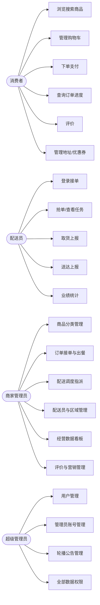
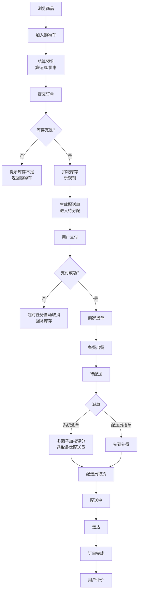

# 轻食预制菜线上订购配送管理系统 —— 需求分析

> 本文档是论文第二章的直接素材，按"可直接改写成论文正文"的标准撰写。
> 论文对应章节：**第 2 章 相关技术介绍 / 第 3 章 系统分析**

---

## 一、项目背景与研究意义

### 1.1 背景

近年来居民健康意识提升，"轻食"（低卡、高蛋白、控糖控脂的餐食）在年轻消费群体中快速普及。行业数据显示，轻食消费以线上订餐为主要购买渠道，占比超过 70%。但轻食预制菜与传统餐饮在业务上存在三处显著差异：

1. **保质期约束**：预制菜是工业化生产的半成品，有明确的生产日期与保质期，存在临期、过期管理需求；
2. **营养属性是核心购买依据**：消费者选购时关注热量、蛋白质、脂肪、碳水含量以及过敏原，而非传统外卖的价格与口味；
3. **配送时效敏感**：轻食强调"新鲜"，部分品类需冷藏/冷冻配送，对配送时效与保温有明确要求。

同时，市场上的轻食商家普遍使用微信群接单、人工排单、纸质记账，订单状态流转靠人工喊话，存在**订单错漏、配送冲突、账目不清**等问题，缺乏一体化的线上订购配送管理系统。

### 1.2 研究意义

**理论意义**：探索状态机驱动的订单与配送领域建模方法，以及多因子加权调度算法在即时配送场景下的应用。

**实践意义**：为中小型轻食商家提供一套轻量、可快速上线的经营管理系统，涵盖商品展示、在线订购、支付、配送调度、经营分析全链路。

---

## 二、可行性分析

| 维度 | 分析 | 结论 |
|---|---|---|
| **技术可行性** | Spring Boot、Vue3、MySQL、Redis 均为成熟稳定的技术，社区活跃、文档丰富；所需功能（订单流转、状态机、调度算法）均有成熟实现范式 | **可行** |
| **经济可行性** | 全部使用开源软件（Spring Boot、Vue、Element Plus、MySQL Community、Redis），无商业授权费用；单机部署即可满足毕设演示规模 | **可行** |
| **操作可行性** | 用户端采用移动端 UI，贴近主流外卖操作习惯；管理端采用表格 + 表单 + 图表，学习成本低 | **可行** |
| **法律与合规可行性** | 支付环节采用**沙箱模拟支付**，不接入真实资金通道，无需企业资质，规避合规风险；个人信息仅在演示环境使用虚构数据 | **可行** |
| **时间可行性** | 1-2 个月周期内，通过 P0/P1/P2 三级裁剪保证核心闭环完整（详见 `05-开发计划与进度.md`） | **可行（需严格裁剪）** |

---

## 三、角色分析

系统涉及四类使用者，角色与权限矩阵如下：

| 功能 \ 角色 | 消费者 | 配送员 | 商家管理员 | 超级管理员 |
|---|:---:|:---:|:---:|:---:|
| 浏览商品 / 加购物车 | ✅ | ✅ | ✅ | ✅ |
| 提交订单 / 支付 | ✅ | ❌ | ❌ | ❌ |
| 查看我的订单 | ✅ | ✅ | ✅ | ✅ |
| 取消订单 | ✅ | ❌ | ✅ | ✅ |
| 评价订单 | ✅ | ❌ | ✅ | ✅ |
| 抢单 / 取货 / 送达上报 | ❌ | ✅ | ❌ | ❌ |
| 商品与分类管理 | ❌ | ❌ | ✅ | ✅ |
| 订单管理与状态干预 | ❌ | ❌ | ✅ | ✅ |
| 配送员管理 / 人工指派 | ❌ | ❌ | ✅ | ✅ |
| 配送区域与运费配置 | ❌ | ❌ | ✅ | ✅ |
| 数据看板与报表 | ❌ | ❌ | ✅ | ✅ |
| 用户管理 / 系统配置 | ❌ | ❌ | ❌ | ✅ |

**角色用例图**

---

## 四、功能需求

### 4.1 用户端（前台商城）

| 编号 | 功能名称 | 功能描述 | 优先级 |
|---|---|---|---|
| UF-01 | 用户注册 | 手机号/账号注册，密码加密存储，自动登录 | P0 |
| UF-02 | 用户登录 | 账号密码登录，签发 JWT，令牌有效期 7 天 | P0 |
| UF-03 | 商品分类浏览 | 按一级/二级分类浏览，分类图标导航 | P0 |
| UF-04 | 商品搜索 | 按名称模糊搜索（MySQL ngram 全文索引） | P0 |
| UF-05 | 商品详情 | 展示图片、价格、规格、可选项、营养成分、过敏原、储存与加热方式 | P0 |
| UF-06 | 条件筛选 | 按分类、价格区间、**热量区间**、健康标签筛选 | P0 |
| UF-07 | 购物车 | 加入购物车、改数量、改规格选项、删除、勾选、合计金额 | P0 |
| UF-08 | 结算预览 | 选择地址、配送方式、期望时间、优惠券，试算商品总额/运费/优惠/实付 | P0 |
| UF-09 | 提交订单 | 后端重新计价校验，扣减库存，生成订单与明细，生成配送单 | P0 |
| UF-10 | 模拟支付 | 沙箱收银台，支持微信/支付宝模拟，支付回调幂等 | P0 |
| UF-11 | 订单列表 | 按全部/待支付/待配送/配送中/已完成筛选 | P0 |
| UF-12 | 订单详情 | 订单信息 + 明细 + **配送进度时间轴** | P0 |
| UF-13 | 取消订单 | 待支付/待接单状态可取消，库存回补 | P1 |
| UF-14 | 收货地址管理 | 增删改查、设为默认、经纬度记录 | P0 |
| UF-15 | 订单评价 | 评分 + 图文评价，商家可回复 | P1 |
| UF-16 | 优惠券 | 领取、查看、使用、满减计算 | P1 |
| UF-17 | 收藏 / 浏览历史 | 收藏商品、记录浏览足迹 | P1 |
| UF-18 | 个人中心 | 资料修改、密码修改、消费统计 | P0 |

### 4.2 管理端（后台管理系统）

| 编号 | 功能名称 | 功能描述 | 优先级 |
|---|---|---|---|
| MF-01 | 管理员登录与鉴权 | 登录验证，注解式 RBAC 权限控制 | P0 |
| MF-02 | 数据看板 | 今日营业额/订单数/用户数/待配送量、7 日趋势图、销量 Top10、区域分布 | P0 |
| MF-03 | 商品管理 | 增删改查、上下架、库存管理、营养属性维护、图集上传 | P0 |
| MF-04 | 分类管理 | 树形增删改查、排序、启用停用 | P0 |
| MF-05 | 订单管理 | 多条件查询（订单号/用户/状态/时间）、查看详情、状态干预、取消订单 | P0 |
| MF-06 | 配送员管理 | 增删改查、启用停用、重置密码、设置负载上限与所属区域 | P0 |
| MF-07 | 配送调度 | 查看配送单、人工指派配送员、查看派单日志 | P0 |
| MF-08 | 配送区域与运费配置 | 区域增删改查、起步价/里程费/免运费门槛/夜间附加费配置 | P1 |
| MF-09 | 用户管理 | 用户列表、详情、启用禁用 | P1 |
| MF-10 | 优惠券管理 | 券模板创建、发放、停用、使用统计 | P1 |
| MF-11 | 评价管理 | 评价列表、删除、回复 | P1 |
| MF-12 | 轮播 / 公告管理 | 首页轮播配置、系统公告发布 | P1 |
| MF-13 | 报表导出 | 订单明细、销售报表导出 Excel | P2 |

### 4.3 配送员端

| 编号 | 功能名称 | 功能描述 | 优先级 |
|---|---|---|---|
| DF-01 | 配送员登录 | 独立账号体系，签发带角色标识的 JWT | P0 |
| DF-02 | 待接订单大厅 | 展示待分配订单（收货区域、商品量、时间要求、预计配送费） | P0 |
| DF-03 | 抢单 | 并发安全的一键抢单（乐观锁） | P0 |
| DF-04 | 我的任务 | 我的配送单列表，按状态分组 | P0 |
| DF-05 | 取货上报 | 确认取货，状态流转至"配送中" | P0 |
| DF-06 | 送达上报 | 确认送达，同步完成订单，记录轨迹点 | P0 |
| DF-07 | 上下线切换 | 在线/离线、休息状态切换，影响是否参与派单 | P0 |
| DF-08 | 业绩统计 | 今日单量、累计单量、累计收入、评分 | P1 |

---

## 五、业务流程分析

### 5.1 订单主流程

### 5.2 订单状态机

见 `02-数据库设计.md` 4.10 节的状态定义表，论文中需配**状态图**（UML State Diagram）。

### 5.3 配送流程

---

## 六、数据需求（数据字典摘录）

完整 DDL 见 `02-数据库设计.md`。此处列出需要在论文中作为数据字典呈现的核心表与主要字段：

| 表名 | 字段 | 类型 | 约束 | 说明 |
|---|---|---|---|---|
| t_order | id | BIGINT | PK, AUTO_INCREMENT | 订单ID |
| t_order | order_no | VARCHAR(32) | UNIQUE, NOT NULL | 订单号（业务唯一键） |
| t_order | status | TINYINT | NOT NULL, DEFAULT 0 | 订单状态枚举 |
| t_order | pay_amount | DECIMAL(12,2) | NOT NULL | 实付金额 |
| t_order | goods_amount | DECIMAL(12,2) | NOT NULL | 商品总额 |
| t_order | freight_amount | DECIMAL(12,2) | NOT NULL | 配送费 |
| t_order | discount_amount | DECIMAL(12,2) | NOT NULL | 优惠金额 |
| t_order | receiver_address | VARCHAR(255) | NOT NULL | 地址快照 |
| t_order | delivery_man_id | BIGINT | FK→t_delivery_man | 配送员 |
| t_order_item | product_name | VARCHAR(100) | NOT NULL | 商品名快照 |
| t_order_item | price | DECIMAL(10,2) | NOT NULL | 成交单价快照 |
| t_product | calories | INT | NOT NULL | 热量 kcal |
| t_product | allergens | VARCHAR(255) | NULL | 过敏原 |
| t_product | shelf_life_days | INT | NOT NULL | 保质期天数 |
| t_delivery_order | status | TINYINT | NOT NULL | 配送状态枚举 |
| t_delivery_order | assign_type | TINYINT | NOT NULL | 派单方式 |
| t_delivery_man | max_order_num | INT | NOT NULL | 负载上限 |
| t_delivery_area | base_fee | DECIMAL(10,2) | NOT NULL | 起步配送费 |
| t_delivery_area | free_threshold | DECIMAL(12,2) | NOT NULL | 免运费门槛 |

---

## 七、非功能需求

| 编号 | 类别 | 需求描述 | 验收标准 |
|---|---|---|---|
| NF-01 | 性能 | 商品列表、订单列表响应时间 | 常规数据量下 P95 < 500ms |
| NF-02 | 性能 | 管理端看板统计查询 | 10 万订单量下 < 2s（可用索引优化） |
| NF-03 | 安全 | 密码加密存储 | BCrypt，禁止明文/可逆加密 |
| NF-04 | 安全 | 接口鉴权 | 无 token 访问受保护接口返回 401；越权返回 403 |
| NF-05 | 安全 | 金额防篡改 | 订单金额全部由服务端计算，前端传入金额被忽略 |
| NF-06 | 可靠性 | 支付幂等 | 重复回调不重复改状态、不重复扣库存 |
| NF-07 | 可用性 | 移动端适配 | 用户端在 375px 宽度下无横向滚动 |
| NF-08 | 可维护性 | 代码规范 | 统一响应体、统一异常处理、状态值集中枚举 |
| NF-09 | 可移植性 | 环境无关 | 数据库连接、端口、文件路径通过配置文件外置 |

---

## 八、需求到实现的追溯矩阵（论文可用）

| 需求编号 | 对应实现类/模块 | 对应接口 |
|---|---|---|
| UF-08 结算预览 | `OrderSettleService` | `POST /api/shop/cart/settle` |
| UF-09 提交订单 | `OrderService.submitOrder` | `POST /api/shop/order` |
| UF-10 模拟支付 | `PaymentService.mockPay` | `POST /api/shop/order/{orderNo}/pay` |
| UF-12 订单详情 | `OrderService.getOrderDetail` | `GET /api/shop/order/{orderNo}` |
| MF-02 数据看板 | `DashboardService` | `GET /api/admin/dashboard/*` |
| MF-07 配送调度 | `DeliveryAssignService` | `PUT /api/admin/delivery/order/{id}/assign` |
| DF-03 抢单 | `DeliveryOrderService.grab` | `POST /api/rider/task/{deliveryNo}/grab` |

---

## 九、需求变更管理

采用轻量级变更控制：

1. 需求变更由指导教师或本人提出，记录在《需求变更记录表》（编号、提出日期、变更内容、影响模块、审批状态）；
2. 变更影响数据库结构时，必须同步修改本文档与 `02-数据库设计.md`，保证文档与实现一致；
3. P0 功能的需求变更必须评估工期影响；P1/P2 功能的变更可延后到下一迭代。
