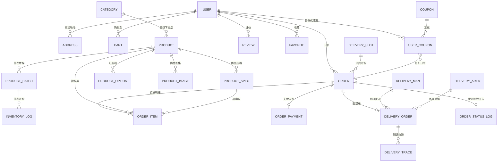

# 轻食预制菜线上订购配送管理系统 —— 数据库设计

> 目标数据库：MySQL 8.0.x　字符集：utf8mb4 / utf8mb4_0900_ai_ci　引擎：InnoDB
> 设计原则：满足第三范式（3NF）、关键历史数据快照冗余、状态流转全程留痕、核心业务表逻辑删除

---

## 一、设计原则

| 编号 | 原则 | 具体做法 |
|---|---|---|
| P1 | 关系模型规范化 | 拆解出分类、商品、规格、配料、优惠券等独立实体，消除多值字段 |
| P2 | 历史数据快照 | 订单明细冗余商品名称、图片、单价与规格，下单时写入快照，不实时关联商品表 |
| P3 | 状态机驱动 | 所有状态字段使用枚举，配套 `*_status_log` 日志表记录每一次流转 |
| P4 | 逻辑删除 | 用户、商品、地址等使用 `deleted` 标记而非物理删除 |
| P5 | 统一审计字段 | `create_time` / `update_time` / `create_by` |
| P6 | 并发安全 | 库存与优惠券核销使用乐观锁版本号 |

---

## 二、实体关系图（ER）



**核心关系说明**

- `ORDER` 与 `ORDER_ITEM` 是 1:N，订单金额永远由明细计算汇总，不在主表硬写商品总价逻辑之外的冗余。
- `ORDER` 与 `DELIVERY_ORDER` 是 1:0..1（虚拟商品/门店自提可不生成配送单）。
- `DELIVERY_ORDER` 与 `DELIVERY_MAN` 是 N:1，一张订单只由一名配送员承接。
- `COUPON`（模板）与 `USER_COUPON`（用户持有的券实例）分离，是标准的"券模板-券实例"模型。

---

## 三、表清单与优先级

### P0 核心表（必做，共 22 张）

| # | 表名 | 中文名 | 说明 |
|---|---|---|---|
| 1 | `t_user` | 用户表 | 消费者账号 |
| 2 | `t_admin` | 管理员表 | 后台账号，角色区分超管/运营 |
| 3 | `t_delivery_man` | 配送员表 | 配送端账号与工作状态 |
| 4 | `t_address` | 收货地址表 | 含经纬度 |
| 5 | `t_category` | 商品分类表 | 支持二级 |
| 6 | `t_product` | 商品/套餐表 | 含轻食营养属性 |
| 7 | `t_product_spec` | 商品规格表 | 份量/口味规格 |
| 8 | `t_product_option` | 商品选项组表 | 加料/忌口选项组 |
| 9 | `t_product_option_item` | 商品选项明细表 | 组内具体选项与加价 |
| 10 | `t_product_image` | 商品图集表 | 多图轮播 |
| 11 | `t_product_batch` | 商品批次表 | 生产日期、效期与 FEFO 出库 |
| 12 | `t_inventory_log` | 库存变动流水表 | 进销存变动留痕 |
| 13 | `t_cart` | 购物车表 | 冗余商品快照便于列表渲染 |
| 14 | `t_order` | 订单主表 | 状态机核心 |
| 15 | `t_order_item` | 订单明细表 | 下单快照 |
| 16 | `t_order_status_log` | 订单状态流转日志 | 留痕与轨迹展示 |
| 17 | `t_payment` | 支付流水表 | 模拟支付 |
| 18 | `t_delivery_order` | 配送单表 | 配送状态机核心 |
| 19 | `t_delivery_trace` | 配送轨迹表 | 实时位置记录 |
| 20 | `t_delivery_area` | 配送区域表 | 区域与运费规则 |
| 21 | `t_delivery_slot` | 配送时段配置表 | 预约配送时段 |
| 22 | `t_delivery_man_log` | 派单日志表 | 记录派单策略命中结果 |

### P1 选做表（有余力再做，共 8 张）

| # | 表名 | 中文名 |
|---|---|---|
| 24 | `t_coupon` | 优惠券模板 |
| 25 | `t_user_coupon` | 用户优惠券 |
| 26 | `t_review` | 订单评价 |
| 27 | `t_favorite` | 商品收藏 |
| 28 | `t_browsing_history` | 浏览历史 |
| 29 | `t_banner` | 首页轮播 |
| 30 | `t_notice` | 系统公告 |
| 31 | `t_coupon_rule` | 满减规则（无券时启用） |

### P2 选做表

| # | 表名 | 中文名 |
|---|---|---|
| 32 | `t_refund` | 售后退款申请 |

---

## 四、核心表详细设计（DDL）

### 4.1 用户表 `t_user`

```sql
CREATE TABLE `t_user` (
    `id`            BIGINT       NOT NULL AUTO_INCREMENT COMMENT '用户ID',
    `username`      VARCHAR(50)  NOT NULL                COMMENT '登录账号',
    `password`      VARCHAR(100) NOT NULL                COMMENT 'BCrypt 加密密码',
    `nickname`      VARCHAR(50)  NOT NULL DEFAULT ''     COMMENT '昵称',
    `phone`         VARCHAR(20)  DEFAULT NULL            COMMENT '手机号',
    `avatar`        VARCHAR(255) DEFAULT NULL            COMMENT '头像地址',
    `gender`        TINYINT      NOT NULL DEFAULT 0       COMMENT '性别 0未知 1男 2女',
    `birthday`      DATE         DEFAULT NULL            COMMENT '生日',
    `total_amount`  DECIMAL(12,2) NOT NULL DEFAULT 0.00  COMMENT '累计消费',
    `order_count`   INT          NOT NULL DEFAULT 0       COMMENT '累计订单数',
    `status`        TINYINT      NOT NULL DEFAULT 1       COMMENT '状态 0禁用 1正常',
    `deleted`       TINYINT      NOT NULL DEFAULT 0       COMMENT '逻辑删除 0否 1是',
    `create_time`   DATETIME     NOT NULL DEFAULT CURRENT_TIMESTAMP,
    `update_time`   DATETIME     NOT NULL DEFAULT CURRENT_TIMESTAMP ON UPDATE CURRENT_TIMESTAMP,
    PRIMARY KEY (`id`),
    UNIQUE KEY `uk_username` (`username`),
    KEY `idx_phone` (`phone`)
) ENGINE=InnoDB COMMENT='用户表';
```

> **字段边界**：用户表仅存放账号与交易信息。热量信息仅作为商品静态属性，用于展示与筛选，不与用户画像关联。

### 4.2 管理员表 `t_admin`

```sql
CREATE TABLE `t_admin` (
    `id`          BIGINT      NOT NULL AUTO_INCREMENT COMMENT '管理员ID',
    `username`    VARCHAR(50) NOT NULL                COMMENT '登录账号',
    `password`    VARCHAR(100) NOT NULL               COMMENT 'BCrypt 加密密码',
    `real_name`   VARCHAR(50) NOT NULL DEFAULT ''     COMMENT '真实姓名',
    `avatar`      VARCHAR(255) DEFAULT NULL,
    `phone`       VARCHAR(20) DEFAULT NULL,
    `role`        VARCHAR(20) NOT NULL DEFAULT 'operator' COMMENT '角色 super_admin/operator',
    `status`      TINYINT     NOT NULL DEFAULT 1      COMMENT '状态 0禁用 1正常',
    `last_login_time` DATETIME DEFAULT NULL           COMMENT '最后登录时间',
    `deleted`     TINYINT     NOT NULL DEFAULT 0,
    `create_time` DATETIME    NOT NULL DEFAULT CURRENT_TIMESTAMP,
    `update_time` DATETIME    NOT NULL DEFAULT CURRENT_TIMESTAMP ON UPDATE CURRENT_TIMESTAMP,
    PRIMARY KEY (`id`),
    UNIQUE KEY `uk_username` (`username`)
) ENGINE=InnoDB COMMENT='管理员表';
```

### 4.3 配送员表 `t_delivery_man`

```sql
CREATE TABLE `t_delivery_man` (
    `id`            BIGINT      NOT NULL AUTO_INCREMENT COMMENT '配送员ID',
    `username`      VARCHAR(50) NOT NULL                COMMENT '登录账号',
    `password`      VARCHAR(100) NOT NULL               COMMENT 'BCrypt 加密密码',
    `real_name`     VARCHAR(50) NOT NULL                COMMENT '姓名',
    `phone`         VARCHAR(20) NOT NULL                COMMENT '联系电话',
    `avatar`        VARCHAR(255) DEFAULT NULL,
    `work_status`   TINYINT     NOT NULL DEFAULT 0       COMMENT '工作状态 0空闲 1配送中 2休息',
    `online_status` TINYINT     NOT NULL DEFAULT 0       COMMENT '在线状态 0离线 1在线',
    `service_area_id` BIGINT    DEFAULT NULL            COMMENT '所属配送区域ID',
    `longitude`      DECIMAL(10,7) DEFAULT NULL          COMMENT '当前位置经度(GCJ-02)',
    `latitude`       DECIMAL(10,7) DEFAULT NULL          COMMENT '当前位置纬度(GCJ-02)',
    `max_order_num` INT         NOT NULL DEFAULT 5       COMMENT '最大同时接单数(负载上限)',
    `today_order_count` INT     NOT NULL DEFAULT 0       COMMENT '今日完成单量',
    `total_order_count` INT     NOT NULL DEFAULT 0       COMMENT '累计完成单量',
    `total_income`  DECIMAL(12,2) NOT NULL DEFAULT 0.00 COMMENT '累计配送收入',
    `rating`        DECIMAL(3,2) NOT NULL DEFAULT 5.00   COMMENT '评分',
    `status`        TINYINT     NOT NULL DEFAULT 1       COMMENT '账号状态 0禁用 1正常',
    `deleted`       TINYINT     NOT NULL DEFAULT 0,
    `create_time`   DATETIME    NOT NULL DEFAULT CURRENT_TIMESTAMP,
    `update_time`   DATETIME    NOT NULL DEFAULT CURRENT_TIMESTAMP ON UPDATE CURRENT_TIMESTAMP,
    PRIMARY KEY (`id`),
    UNIQUE KEY `uk_username` (`username`),
    KEY `idx_work_status` (`work_status`, `online_status`)
) ENGINE=InnoDB COMMENT='配送员表';
```

> **派单输入**：`max_order_num`、`work_status`、`online_status` 用于负载因子计算；`longitude`、`latitude` 用于计算配送员到收货地址的距离并参与派单评分。

### 4.4 收货地址表 `t_address`

```sql
CREATE TABLE `t_address` (
    `id`          BIGINT      NOT NULL AUTO_INCREMENT,
    `user_id`     BIGINT      NOT NULL                COMMENT '所属用户',
    `receiver`    VARCHAR(50) NOT NULL                COMMENT '收货人',
    `phone`       VARCHAR(20) NOT NULL                COMMENT '联系电话',
    `province`    VARCHAR(30) NOT NULL                COMMENT '省',
    `city`        VARCHAR(30) NOT NULL                COMMENT '市',
    `district`    VARCHAR(30) NOT NULL                COMMENT '区/县',
    `detail`      VARCHAR(200) NOT NULL               COMMENT '详细地址',
    `longitude`   DECIMAL(10,7) DEFAULT NULL          COMMENT '经度(GCJ-02)',
    `latitude`    DECIMAL(10,7) DEFAULT NULL          COMMENT '纬度(GCJ-02)',
    `tag`         VARCHAR(20) DEFAULT NULL            COMMENT '标签 家/公司/学校',
    `is_default`  TINYINT     NOT NULL DEFAULT 0       COMMENT '是否默认地址',
    `deleted`     TINYINT     NOT NULL DEFAULT 0,
    `create_time` DATETIME    NOT NULL DEFAULT CURRENT_TIMESTAMP,
    `update_time` DATETIME    NOT NULL DEFAULT CURRENT_TIMESTAMP ON UPDATE CURRENT_TIMESTAMP,
    PRIMARY KEY (`id`),
    KEY `idx_user` (`user_id`)
) ENGINE=InnoDB COMMENT='收货地址表';
```

> 经纬度用于计算直线距离，是运费计算与派单距离因子的数据基础。

### 4.5 商品分类表 `t_category`

```sql
CREATE TABLE `t_category` (
    `id`          BIGINT      NOT NULL AUTO_INCREMENT,
    `parent_id`   BIGINT      NOT NULL DEFAULT 0       COMMENT '父分类ID 0为一级',
    `name`        VARCHAR(50) NOT NULL                COMMENT '分类名称',
    `icon`        VARCHAR(255) DEFAULT NULL           COMMENT '分类图标',
    `sort`        INT         NOT NULL DEFAULT 0       COMMENT '排序值',
    `status`      TINYINT     NOT NULL DEFAULT 1       COMMENT '状态 0停用 1启用',
    `deleted`     TINYINT     NOT NULL DEFAULT 0,
    `create_time` DATETIME    NOT NULL DEFAULT CURRENT_TIMESTAMP,
    `update_time` DATETIME    NOT NULL DEFAULT CURRENT_TIMESTAMP ON UPDATE CURRENT_TIMESTAMP,
    PRIMARY KEY (`id`),
    KEY `idx_parent` (`parent_id`)
) ENGINE=InnoDB COMMENT='商品分类表';
```

### 4.6 商品表 `t_product`（轻食领域核心表）

```sql
CREATE TABLE `t_product` (
    `id`             BIGINT       NOT NULL AUTO_INCREMENT,
    `category_id`    BIGINT       NOT NULL                COMMENT '分类ID',
    `name`           VARCHAR(100) NOT NULL                COMMENT '商品名称',
    `subtitle`       VARCHAR(200) DEFAULT NULL            COMMENT '副标题/卖点',
    `cover`          VARCHAR(255) DEFAULT NULL            COMMENT '主图',
    `detail`         TEXT         DEFAULT NULL            COMMENT '图文详情',
    `product_type`   TINYINT      NOT NULL DEFAULT 1       COMMENT '类型 1单品 2套餐',
    `price`          DECIMAL(10,2) NOT NULL               COMMENT '基础售价',
    `original_price` DECIMAL(10,2) DEFAULT NULL            COMMENT '划线原价',
    `unit`           VARCHAR(20)  NOT NULL DEFAULT '份'   COMMENT '单位',
    `stock`          INT          NOT NULL DEFAULT 0       COMMENT '总库存',
    `sales_count`    INT          NOT NULL DEFAULT 0       COMMENT '销量',
    `status`         TINYINT      NOT NULL DEFAULT 1       COMMENT '状态 0下架 1上架',
    `is_recommend`   TINYINT      NOT NULL DEFAULT 0       COMMENT '是否推荐',
    `sort`           INT          NOT NULL DEFAULT 0       COMMENT '排序值',
    `version`        INT          NOT NULL DEFAULT 0       COMMENT '乐观锁版本号',

    -- ===== 轻食营养属性（领域特性） =====
    `calories`       INT          NOT NULL DEFAULT 0       COMMENT '热量 kcal',
    `protein`        DECIMAL(6,1) NOT NULL DEFAULT 0.0     COMMENT '蛋白质 g',
    `fat`            DECIMAL(6,1) NOT NULL DEFAULT 0.0     COMMENT '脂肪 g',
    `carbohydrate`   DECIMAL(6,1) NOT NULL DEFAULT 0.0     COMMENT '碳水化合物 g',
    `sodium`         DECIMAL(6,1) NOT NULL DEFAULT 0.0     COMMENT '钠含量 mg',
    `nutrition_desc` VARCHAR(255) DEFAULT NULL            COMMENT '营养说明文案',
    `allergens`      VARCHAR(255) DEFAULT NULL            COMMENT '过敏原 逗号分隔 如：花生,乳制品',
    `storage_type`   TINYINT      NOT NULL DEFAULT 1       COMMENT '储存方式 1常温 2冷藏 3冷冻',
    `shelf_life_days` INT         NOT NULL DEFAULT 0       COMMENT '保质期(天)',
    `producer`       VARCHAR(100) DEFAULT NULL            COMMENT '生产商/中央厨房',
    `heating_method` VARCHAR(100) DEFAULT NULL            COMMENT '食用方式 如：微波炉加热2分钟',
    `health_tags`    VARCHAR(100) DEFAULT NULL            COMMENT '健康标签 逗号分隔 如：高蛋白,低脂',
    `default_spec_id` BIGINT      DEFAULT NULL            COMMENT '默认规格ID',

    `deleted`        TINYINT      NOT NULL DEFAULT 0,
    `create_time`    DATETIME     NOT NULL DEFAULT CURRENT_TIMESTAMP,
    `update_time`    DATETIME     NOT NULL DEFAULT CURRENT_TIMESTAMP ON UPDATE CURRENT_TIMESTAMP,
    PRIMARY KEY (`id`),
    KEY `idx_category` (`category_id`, `status`),
    KEY `idx_sales` (`sales_count`),
    KEY `idx_price` (`price`),
    FULLTEXT KEY `ft_name` (`name`) WITH PARSER ngram
) ENGINE=InnoDB COMMENT='商品表（含轻食营养属性）';
```

> **字段用途**：
> 1. `calories`、`protein`、`fat`、`carbohydrate`、`sodium` 用于热量区间筛选与整单热量合计。
> 2. `allergens` 用于商品详情中的过敏原提示。
> 3. `storage_type` 与 `shelf_life_days` 用于储存方式和保质期管理。
> 4. `version` 用于库存扣减的乐观锁校验。

### 4.7 商品规格表 `t_product_spec`

```sql
CREATE TABLE `t_product_spec` (
    `id`          BIGINT       NOT NULL AUTO_INCREMENT,
    `product_id`  BIGINT       NOT NULL                COMMENT '商品ID',
    `name`        VARCHAR(50)  NOT NULL                COMMENT '规格名 如：小份/标准份/大份',
    `price_delta` DECIMAL(10,2) NOT NULL DEFAULT 0.00  COMMENT '加价(可负)',
    `stock`       INT          NOT NULL DEFAULT 0       COMMENT '规格库存',
    `calories`    INT          NOT NULL DEFAULT 0       COMMENT '该规格热量 kcal',
    `is_default`  TINYINT      NOT NULL DEFAULT 0       COMMENT '是否默认规格',
    `sort`        INT          NOT NULL DEFAULT 0,
    `status`      TINYINT      NOT NULL DEFAULT 1       COMMENT '状态 0停用 1启用',
    `create_time` DATETIME     NOT NULL DEFAULT CURRENT_TIMESTAMP,
    `update_time` DATETIME     NOT NULL DEFAULT CURRENT_TIMESTAMP ON UPDATE CURRENT_TIMESTAMP,
    PRIMARY KEY (`id`),
    KEY `idx_product` (`product_id`)
) ENGINE=InnoDB COMMENT='商品规格表';
```

### 4.8 商品可选项表 `t_product_option`（定制加料/忌口）

```sql
CREATE TABLE `t_product_option` (
    `id`          BIGINT      NOT NULL AUTO_INCREMENT,
    `product_id`  BIGINT      NOT NULL                COMMENT '商品ID',
    `name`        VARCHAR(50) NOT NULL                COMMENT '选项组名 如：加料/去料/辣度',
    `type`        TINYINT     NOT NULL DEFAULT 1       COMMENT '类型 1单选 2多选',
    `required`    TINYINT     NOT NULL DEFAULT 0       COMMENT '是否必选',
    `sort`        INT         NOT NULL DEFAULT 0,
    `create_time` DATETIME    NOT NULL DEFAULT CURRENT_TIMESTAMP,
    `update_time` DATETIME    NOT NULL DEFAULT CURRENT_TIMESTAMP ON UPDATE CURRENT_TIMESTAMP,
    PRIMARY KEY (`id`),
    KEY `idx_product` (`product_id`)
) ENGINE=InnoDB COMMENT='商品选项组表';

CREATE TABLE `t_product_option_item` (
    `id`          BIGINT       NOT NULL AUTO_INCREMENT,
    `option_id`   BIGINT       NOT NULL                COMMENT '选项组ID',
    `name`        VARCHAR(50)  NOT NULL                COMMENT '选项名 如：加鸡胸肉/去香菜',
    `price_delta` DECIMAL(10,2) NOT NULL DEFAULT 0.00  COMMENT '加价',
    `calories`    INT          NOT NULL DEFAULT 0       COMMENT '附加热量 kcal',
    `sort`        INT          NOT NULL DEFAULT 0,
    `status`      TINYINT      NOT NULL DEFAULT 1,
    `create_time` DATETIME     NOT NULL DEFAULT CURRENT_TIMESTAMP,
    `update_time` DATETIME     NOT NULL DEFAULT CURRENT_TIMESTAMP ON UPDATE CURRENT_TIMESTAMP,
    PRIMARY KEY (`id`),
    KEY `idx_option` (`option_id`)
) ENGINE=InnoDB COMMENT='商品选项明细表';
```

### 4.9 购物车表 `t_cart`

```sql
CREATE TABLE `t_cart` (
    `id`          BIGINT      NOT NULL AUTO_INCREMENT,
    `user_id`     BIGINT      NOT NULL                COMMENT '用户ID',
    `product_id`  BIGINT      NOT NULL                COMMENT '商品ID',
    `spec_id`     BIGINT      DEFAULT NULL            COMMENT '规格ID',
    `quantity`    INT         NOT NULL DEFAULT 1       COMMENT '数量',
    `options`     VARCHAR(500) DEFAULT NULL           COMMENT '已选选项 JSON 快照',
    `checked`     TINYINT     NOT NULL DEFAULT 1       COMMENT '是否勾选',
    `product_name` VARCHAR(100) NOT NULL DEFAULT ''   COMMENT '商品名快照(冗余)',
    `cover`       VARCHAR(255) DEFAULT NULL           COMMENT '图片快照(冗余)',
    `price`       DECIMAL(10,2) NOT NULL DEFAULT 0.00 COMMENT '单价快照(冗余)',
    `create_time` DATETIME    NOT NULL DEFAULT CURRENT_TIMESTAMP,
    `update_time` DATETIME    NOT NULL DEFAULT CURRENT_TIMESTAMP ON UPDATE CURRENT_TIMESTAMP,
    PRIMARY KEY (`id`),
    KEY `idx_user` (`user_id`, `checked`)
) ENGINE=InnoDB COMMENT='购物车表';
```

### 4.10 订单主表 `t_order`（核心）

```sql
CREATE TABLE `t_order` (
    `id`             BIGINT       NOT NULL AUTO_INCREMENT,
    `order_no`       VARCHAR(32)  NOT NULL                COMMENT '订单号',
    `user_id`        BIGINT       NOT NULL                COMMENT '下单用户ID',

    -- ===== 金额构成 =====
    `goods_amount`   DECIMAL(12,2) NOT NULL DEFAULT 0.00  COMMENT '商品总额',
    `freight_amount` DECIMAL(12,2) NOT NULL DEFAULT 0.00  COMMENT '配送费',
    `discount_amount` DECIMAL(12,2) NOT NULL DEFAULT 0.00 COMMENT '优惠金额',
    `pay_amount`     DECIMAL(12,2) NOT NULL DEFAULT 0.00  COMMENT '实付金额',
    `delivery_man_fee` DECIMAL(12,2) NOT NULL DEFAULT 0.00 COMMENT '配送员配送提成',

    -- ===== 地址快照（不可变） =====
    `receiver`       VARCHAR(50)  NOT NULL DEFAULT ''     COMMENT '收货人快照',
    `receiver_phone` VARCHAR(20)  NOT NULL DEFAULT ''     COMMENT '收货电话快照',
    `receiver_address` VARCHAR(255) NOT NULL DEFAULT ''   COMMENT '收货地址快照',
    `longitude`      DECIMAL(10,7) DEFAULT NULL           COMMENT '收货经度',
    `latitude`       DECIMAL(10,7) DEFAULT NULL           COMMENT '收货纬度',

    -- ===== 配送信息 =====
    `delivery_type`  TINYINT      NOT NULL DEFAULT 1       COMMENT '配送方式 1外卖配送 2到店自提',
    `expect_time`    DATETIME     DEFAULT NULL            COMMENT '期望送达时间',
    `delivery_slot_id` BIGINT     DEFAULT NULL            COMMENT '预约配送时段ID',
    `delivery_slot_date` DATE      DEFAULT NULL            COMMENT '预约配送日期',
    `delivery_slot_name` VARCHAR(30) DEFAULT NULL          COMMENT '配送时段名称快照',
    `delivery_man_id` BIGINT      DEFAULT NULL            COMMENT '配送员ID',
    `delivery_area_id` BIGINT     DEFAULT NULL            COMMENT '配送区域ID',
    `delivery_distance` DECIMAL(8,2) DEFAULT NULL         COMMENT '配送距离 km',

    -- ===== 状态机 =====
    `status`         TINYINT      NOT NULL DEFAULT 0       COMMENT '订单状态 见状态机定义',
    `pay_status`     TINYINT      NOT NULL DEFAULT 0       COMMENT '支付状态 0未支付 1已支付 2已退款',
    `pay_type`       TINYINT      NOT NULL DEFAULT 0       COMMENT '支付方式 0未支付 1微信 2支付宝 3余额',
    `pay_time`       DATETIME     DEFAULT NULL            COMMENT '支付时间',

    -- ===== 其他 =====
    `remark`         VARCHAR(255) DEFAULT NULL            COMMENT '用户备注',
    `cancel_reason`  VARCHAR(255) DEFAULT NULL            COMMENT '取消原因',
    `cancel_time`    DATETIME     DEFAULT NULL            COMMENT '取消时间',
    `finish_time`    DATETIME     DEFAULT NULL            COMMENT '完成时间',
    `user_coupon_id` BIGINT       DEFAULT NULL            COMMENT '使用的用户优惠券ID',

    `create_time`    DATETIME     NOT NULL DEFAULT CURRENT_TIMESTAMP,
    `update_time`    DATETIME     NOT NULL DEFAULT CURRENT_TIMESTAMP ON UPDATE CURRENT_TIMESTAMP,
    PRIMARY KEY (`id`),
    UNIQUE KEY `uk_order_no` (`order_no`),
    KEY `idx_user` (`user_id`, `status`),
    KEY `idx_status` (`status`, `create_time`),
    KEY `idx_delivery_man` (`delivery_man_id`),
    KEY `idx_create_time` (`create_time`)
) ENGINE=InnoDB COMMENT='订单主表';
```

#### 订单状态机定义

| 值 | 状态 | 含义 | 允许的下一状态 | 触发方 |
|---|---|---|---|---|
| 0 | WAIT_PAY | 已下单未支付 | 1 待接单 / 9 已取消 | 用户 / 超时任务 |
| 1 | WAIT_ACCEPT | 已支付，等待商家接单 | 2 备餐中 / 9 已取消 | 商家 |
| 2 | PREPARING | 商家出餐中 | 3 待配送时段 / 4 待配送 | 商家 |
| 3 | WAIT_SLOT | 等待预约时段开始（仅预约单） | 4 待配送 | **定时任务**（到点自动流转） |
| 4 | WAIT_DELIVER | 等待分配配送员 | 5 配送中 / 9 已取消 | 系统派单 / 配送员抢单 |
| 5 | DELIVERING | 配送员已取货 | 6 已完成 | 配送员 |
| 6 | FINISHED | 订单送达 | — | — |
| 7 | REFUNDING | 售后处理中 | 8 已退款 | 用户 / 商家 |
| 8 | REFUNDED | 退款完成 | — | — |
| 9 | CANCELLED | 用户取消或商家拒单 | — | — |

**两条流转路径的区别**

```
立即配送单：PREPARING(2) ──────────────► WAIT_DELIVER(4)
预约配送单：PREPARING(2) ─► WAIT_SLOT(3) ─► WAIT_DELIVER(4)
                                            ↑ 到点由定时任务触发
```

> **状态流转日志表** `t_order_status_log`：
> ```sql
> CREATE TABLE `t_order_status_log` (
>     `id`           BIGINT   NOT NULL AUTO_INCREMENT,
>     `order_id`     BIGINT   NOT NULL                COMMENT '订单ID',
>     `order_no`     VARCHAR(32) NOT NULL DEFAULT ''   COMMENT '订单号快照',
>     `from_status`  TINYINT  NOT NULL DEFAULT -1      COMMENT '原状态 -1表示创建',
>     `to_status`    TINYINT  NOT NULL                COMMENT '目标状态',
>     `operator_type` TINYINT NOT NULL DEFAULT 0       COMMENT '操作方 0系统 1用户 2商家 3配送员',
>     `operator_id`  BIGINT   DEFAULT NULL            COMMENT '操作人ID',
>     `operator_name` VARCHAR(50) NOT NULL DEFAULT ''  COMMENT '操作人姓名快照',
>     `remark`       VARCHAR(255) DEFAULT NULL        COMMENT '备注',
>     `create_time`  DATETIME NOT NULL DEFAULT CURRENT_TIMESTAMP,
>     PRIMARY KEY (`id`),
>     KEY `idx_order` (`order_id`)
> ) ENGINE=InnoDB COMMENT='订单状态流转日志表';
> ```

### 4.11 订单明细表 `t_order_item`（快照表）

```sql
CREATE TABLE `t_order_item` (
    `id`           BIGINT       NOT NULL AUTO_INCREMENT,
    `order_id`     BIGINT       NOT NULL                COMMENT '订单ID',
    `order_no`     VARCHAR(32)  NOT NULL DEFAULT ''     COMMENT '订单号快照',
    `user_id`      BIGINT       NOT NULL                COMMENT '用户ID',
    `product_id`   BIGINT       NOT NULL                COMMENT '商品ID',
    `product_name` VARCHAR(100) NOT NULL                COMMENT '商品名称快照',
    `product_cover` VARCHAR(255) DEFAULT NULL           COMMENT '商品图片快照',
    `spec_id`      BIGINT       DEFAULT NULL            COMMENT '规格ID',
    `spec_name`    VARCHAR(50)  DEFAULT NULL            COMMENT '规格名快照',
    `options`      VARCHAR(500) DEFAULT NULL            COMMENT '选项快照 JSON',
    `options_desc` VARCHAR(255) DEFAULT NULL            COMMENT '选项可读文案 如：加鸡胸肉/去香菜',
    `price`        DECIMAL(10,2) NOT NULL                COMMENT '成交单价快照',
    `quantity`     INT          NOT NULL DEFAULT 1       COMMENT '数量',
    `subtotal`     DECIMAL(12,2) NOT NULL                COMMENT '小计 = price * quantity',
    `calories`     INT          NOT NULL DEFAULT 0       COMMENT '单份热量快照 kcal',
    `create_time`  DATETIME     NOT NULL DEFAULT CURRENT_TIMESTAMP,
    PRIMARY KEY (`id`),
    KEY `idx_order` (`order_id`),
    KEY `idx_product` (`product_id`)
) ENGINE=InnoDB COMMENT='订单明细表';
```

> **快照要求**：下单时将商品名称、图片、价格、规格和选项写入订单明细，后续商品信息变化不得影响历史订单的金额、对账与退款。

### 4.12 支付流水表 `t_payment`

```sql
CREATE TABLE `t_payment` (
    `id`           BIGINT       NOT NULL AUTO_INCREMENT,
    `pay_no`       VARCHAR(32)  NOT NULL                COMMENT '支付流水号',
    `order_id`     BIGINT       NOT NULL                COMMENT '订单ID',
    `order_no`     VARCHAR(32)  NOT NULL                COMMENT '订单号快照',
    `user_id`      BIGINT       NOT NULL                COMMENT '用户ID',
    `pay_type`     TINYINT      NOT NULL                COMMENT '支付方式 1微信 2支付宝 3余额',
    `amount`       DECIMAL(12,2) NOT NULL               COMMENT '支付金额',
    `status`       TINYINT      NOT NULL DEFAULT 0       COMMENT '状态 0待支付 1成功 2失败 3已关闭',
    `third_party_no` VARCHAR(64) DEFAULT NULL           COMMENT '第三方交易号(模拟)',
    `notify_content` TEXT         DEFAULT NULL           COMMENT '回调报文(模拟)',
    `pay_time`     DATETIME     DEFAULT NULL            COMMENT '支付成功时间',
    `expire_time`  DATETIME     DEFAULT NULL            COMMENT '支付超时时间',
    `create_time`  DATETIME     NOT NULL DEFAULT CURRENT_TIMESTAMP,
    `update_time`  DATETIME     NOT NULL DEFAULT CURRENT_TIMESTAMP ON UPDATE CURRENT_TIMESTAMP,
    PRIMARY KEY (`id`),
    UNIQUE KEY `uk_pay_no` (`pay_no`),
    KEY `idx_order` (`order_id`)
) ENGINE=InnoDB COMMENT='支付流水表';
```

### 4.13 配送单表 `t_delivery_order`

```sql
CREATE TABLE `t_delivery_order` (
    `id`             BIGINT       NOT NULL AUTO_INCREMENT,
    `delivery_no`    VARCHAR(32)  NOT NULL                COMMENT '配送单号',
    `order_id`       BIGINT       NOT NULL                COMMENT '订单ID',
    `order_no`       VARCHAR(32)  NOT NULL                COMMENT '订单号快照',
    `delivery_man_id` BIGINT      DEFAULT NULL            COMMENT '配送员ID',
    `delivery_man_name` VARCHAR(50) NOT NULL DEFAULT ''  COMMENT '配送员姓名快照',
    `delivery_man_phone` VARCHAR(20) NOT NULL DEFAULT '' COMMENT '配送员电话快照',
    `area_id`        BIGINT       DEFAULT NULL            COMMENT '配送区域ID',
    `distance`       DECIMAL(8,2) NOT NULL DEFAULT 0.00   COMMENT '配送距离 km',
    `freight`        DECIMAL(10,2) NOT NULL DEFAULT 0.00  COMMENT '配送费',
    `man_fee`        DECIMAL(10,2) NOT NULL DEFAULT 0.00  COMMENT '配送员提成',
    `status`         TINYINT      NOT NULL DEFAULT 0       COMMENT '配送状态 见配送状态机',
    `assign_type`    TINYINT      NOT NULL DEFAULT 0       COMMENT '派单方式 0待分配 1系统派单 2配送员抢单 3人工指派',
    `assign_time`    DATETIME     DEFAULT NULL            COMMENT '分配时间',
    `pickup_time`    DATETIME     DEFAULT NULL            COMMENT '取货时间',
    `pickup_address` VARCHAR(255) NOT NULL DEFAULT ''    COMMENT '取货地址(门店)',
    `receive_time`   DATETIME     DEFAULT NULL            COMMENT '送达时间',
    `create_time`    DATETIME     NOT NULL DEFAULT CURRENT_TIMESTAMP,
    `update_time`    DATETIME     NOT NULL DEFAULT CURRENT_TIMESTAMP ON UPDATE CURRENT_TIMESTAMP,
    PRIMARY KEY (`id`),
    UNIQUE KEY `uk_delivery_no` (`delivery_no`),
    UNIQUE KEY `uk_order` (`order_id`),
    KEY `idx_man` (`delivery_man_id`, `status`),
    KEY `idx_status` (`status`)
) ENGINE=InnoDB COMMENT='配送单表';
```

#### 配送状态机

| 值 | 状态 | 允许下一状态 | 触发方 |
|---|---|---|---|
| 0 | 待分配 | 1 已分配 | 系统派单/抢单/人工指派 |
| 1 | 已分配 | 2 取货中 | 配送员确认接单 |
| 2 | 取货中 | 3 配送中 | 配送员点击"已取货" |
| 3 | 配送中 | 4 已送达 | 配送员点击"已送达" |
| 4 | 已送达 | — | — |
| 5 | 已取消 | — | 订单取消回滚 |

### 4.14 配送轨迹表 `t_delivery_trace`

```sql
CREATE TABLE `t_delivery_trace` (
    `id`                BIGINT   NOT NULL AUTO_INCREMENT,
    `delivery_order_id` BIGINT   NOT NULL                COMMENT '配送单ID',
    `longitude`         DECIMAL(10,7) DEFAULT NULL       COMMENT '经度',
    `latitude`          DECIMAL(10,7) DEFAULT NULL       COMMENT '纬度',
    `address`           VARCHAR(255) DEFAULT NULL        COMMENT '位置描述',
    `status`            TINYINT  NOT NULL DEFAULT 0       COMMENT '对应配送状态快照',
    `remark`            VARCHAR(255) DEFAULT NULL        COMMENT '备注',
    `create_time`       DATETIME NOT NULL DEFAULT CURRENT_TIMESTAMP,
    PRIMARY KEY (`id`),
    KEY `idx_delivery` (`delivery_order_id`)
) ENGINE=InnoDB COMMENT='配送轨迹表';
```

### 4.15 配送区域表 `t_delivery_area`

```sql
CREATE TABLE `t_delivery_area` (
    `id`           BIGINT       NOT NULL AUTO_INCREMENT,
    `name`         VARCHAR(50)  NOT NULL                COMMENT '区域名称',
    `city`         VARCHAR(30)  NOT NULL                COMMENT '所属城市',
    `district`     VARCHAR(30)  DEFAULT NULL            COMMENT '覆盖区县 逗号分隔',
    `base_fee`     DECIMAL(10,2) NOT NULL DEFAULT 5.00   COMMENT '起步配送费',
    `per_km_fee`   DECIMAL(10,2) NOT NULL DEFAULT 2.00   COMMENT '每公里加价',
    `free_threshold` DECIMAL(12,2) NOT NULL DEFAULT 0.00 COMMENT '免配送费门槛 0为不免',
    `night_surcharge` DECIMAL(10,2) NOT NULL DEFAULT 0.00 COMMENT '夜间时段附加费',
    `sort`         INT          NOT NULL DEFAULT 0,
    `status`       TINYINT      NOT NULL DEFAULT 1       COMMENT '状态 0停用 1启用',
    `create_time`  DATETIME     NOT NULL DEFAULT CURRENT_TIMESTAMP,
    `update_time`  DATETIME     NOT NULL DEFAULT CURRENT_TIMESTAMP ON UPDATE CURRENT_TIMESTAMP,
    PRIMARY KEY (`id`)
) ENGINE=InnoDB COMMENT='配送区域与运费规则表';
```

### 4.16 派单日志表 `t_delivery_man_log`

```sql
CREATE TABLE `t_delivery_man_log` (
    `id`                BIGINT   NOT NULL AUTO_INCREMENT,
    `delivery_order_id` BIGINT   NOT NULL                COMMENT '配送单ID',
    `candidate_id`      BIGINT   NOT NULL                COMMENT '候选配送员ID',
    `candidate_name`    VARCHAR(50) NOT NULL DEFAULT ''  COMMENT '候选配送员姓名',
    `total_score`       DECIMAL(10,4) NOT NULL DEFAULT 0  COMMENT '综合得分',
    `distance_score`    DECIMAL(10,4) NOT NULL DEFAULT 0  COMMENT '距离得分',
    `load_score`        DECIMAL(10,4) NOT NULL DEFAULT 0  COMMENT '负载得分',
    `rating_score`      DECIMAL(10,4) NOT NULL DEFAULT 0  COMMENT '评分得分',
    `distance_value`    DECIMAL(8,2) NOT NULL DEFAULT 0   COMMENT '实际距离 km',
    `load_value`        INT      NOT NULL DEFAULT 0       COMMENT '当前在途单量',
    `is_final`          TINYINT  NOT NULL DEFAULT 0       COMMENT '是否最终被选中',
    `create_time`       DATETIME NOT NULL DEFAULT CURRENT_TIMESTAMP,
    PRIMARY KEY (`id`),
    KEY `idx_delivery` (`delivery_order_id`)
) ENGINE=InnoDB COMMENT='派单策略日志表';
```

> 本表持久化候选配送员的打分过程、综合得分及最终选中结果。

### 4.17 配送时段配置表 `t_delivery_slot`

```sql
CREATE TABLE `t_delivery_slot` (
    `id`             BIGINT     NOT NULL AUTO_INCREMENT,
    `name`           VARCHAR(30) NOT NULL                COMMENT '时段名称 如：午市 11:00-13:00',
    `start_time`     TIME       NOT NULL                COMMENT '时段开始时间',
    `end_time`       TIME       NOT NULL                COMMENT '时段结束时间',
    `order_deadline` TIME       NOT NULL                COMMENT '当日下单截止时间(如18:00,次日配送)',
    `daily_capacity` INT        NOT NULL DEFAULT 0       COMMENT '每日单量上限 0表示不限',
    `advance_days`   INT        NOT NULL DEFAULT 1       COMMENT '可提前预约天数',
    `sort`           INT        NOT NULL DEFAULT 0       COMMENT '排序值',
    `status`         TINYINT    NOT NULL DEFAULT 1       COMMENT '状态 0停用 1启用',
    `create_time`    DATETIME   NOT NULL DEFAULT CURRENT_TIMESTAMP,
    `update_time`    DATETIME   NOT NULL DEFAULT CURRENT_TIMESTAMP ON UPDATE CURRENT_TIMESTAMP,
    PRIMARY KEY (`id`)
) ENGINE=InnoDB COMMENT='配送时段配置表';
```

> **配置规则**：
> - 时段数据由后台维护，可调整开始时间、结束时间、截止时间与容量。
> - `daily_capacity` 为 0 表示不限容量；非 0 时结算页需校验该时段当日已排单量，超出则该时段不可选。
> - `advance_days` 控制可预约天数（如午市可预约今天和明天）。
> - 订单在 `WAIT_SLOT` 状态停留，由定时任务扫描 `delivery_slot_date + start_time` 到点的订单，自动流转到 `WAIT_DELIVER` 并触发派单。

### 4.18 批次与库存流水表

```sql
CREATE TABLE `t_product_batch` (
    `id`             BIGINT      NOT NULL AUTO_INCREMENT,
    `product_id`     BIGINT      NOT NULL                COMMENT '商品ID',
    `batch_no`       VARCHAR(50) NOT NULL                COMMENT '批次号',
    `production_date` DATE       NOT NULL                COMMENT '生产日期',
    `expire_date`    DATE        NOT NULL                COMMENT '到期日期',
    `stock`          INT         NOT NULL DEFAULT 0       COMMENT '批次可用库存',
    `lock_stock`     INT         NOT NULL DEFAULT 0       COMMENT '已锁定库存(下单未出货)',
    `status`         TINYINT     NOT NULL DEFAULT 1       COMMENT '状态 1正常 2临期 3过期 4售罄',
    `remark`         VARCHAR(255) DEFAULT NULL,
    `create_time`    DATETIME    NOT NULL DEFAULT CURRENT_TIMESTAMP,
    `update_time`    DATETIME    NOT NULL DEFAULT CURRENT_TIMESTAMP ON UPDATE CURRENT_TIMESTAMP,
    PRIMARY KEY (`id`),
    UNIQUE KEY `uk_product_batch` (`product_id`, `batch_no`),
    KEY `idx_expire` (`expire_date`, `status`),
    KEY `idx_product_expire` (`product_id`, `expire_date`)
) ENGINE=InnoDB COMMENT='商品批次表';

CREATE TABLE `t_inventory_log` (
    `id`           BIGINT       NOT NULL AUTO_INCREMENT,
    `product_id`   BIGINT       NOT NULL                COMMENT '商品ID',
    `batch_id`     BIGINT       DEFAULT NULL            COMMENT '批次ID',
    `change_type`  TINYINT      NOT NULL                COMMENT '变动类型 1入库 2出库 3退货 4报损 5盘点 6取消回补',
    `change_num`   INT          NOT NULL                COMMENT '变动数量 正入负出',
    `before_stock` INT          NOT NULL DEFAULT 0       COMMENT '变动前数量',
    `after_stock`  INT          NOT NULL DEFAULT 0       COMMENT '变动后数量',
    `ref_type`     VARCHAR(20)  DEFAULT NULL            COMMENT '关联单据类型 order/refund',
    `ref_no`       VARCHAR(32)  DEFAULT NULL            COMMENT '关联单号',
    `operator_id`  BIGINT       DEFAULT NULL            COMMENT '操作人ID',
    `remark`       VARCHAR(255) DEFAULT NULL,
    `create_time`  DATETIME     NOT NULL DEFAULT CURRENT_TIMESTAMP,
    PRIMARY KEY (`id`),
    KEY `idx_product` (`product_id`),
    KEY `idx_batch` (`batch_id`),
    KEY `idx_ref` (`ref_no`)
) ENGINE=InnoDB COMMENT='库存变动流水表';
```

> **出库规则**：批次库存按 **FEFO（First Expired First Out，先到期先出）** 策略扣减，即按 `expire_date ASC` 依次出库，直到满足订单数量。
> `lock_stock` 用于下单占用与超时取消回补的分离记账，避免"扣了又退、退了再扣"导致库存漂移。

### 4.19 其他 P1 选做表结构（DDL 摘要）

<details>
<summary>点击展开：优惠券 / 评价 / 收藏 / 轮播 / 公告 / 批次 / 库存流水</summary>

```sql
-- 优惠券模板
CREATE TABLE `t_coupon` (
    `id`            BIGINT       NOT NULL AUTO_INCREMENT,
    `name`          VARCHAR(50)  NOT NULL                COMMENT '优惠券名称',
    `type`          TINYINT      NOT NULL DEFAULT 1       COMMENT '类型 1满减 2折扣',
    `threshold`     DECIMAL(12,2) NOT NULL DEFAULT 0.00  COMMENT '使用门槛金额',
    `amount`        DECIMAL(12,2) NOT NULL DEFAULT 0.00  COMMENT '优惠金额(type=2时为折扣率)',
    `start_time`    DATETIME     NOT NULL                COMMENT '生效时间',
    `end_time`      DATETIME     NOT NULL                COMMENT '失效时间',
    `total_count`   INT          NOT NULL DEFAULT 0       COMMENT '发放总量',
    `received_count` INT         NOT NULL DEFAULT 0       COMMENT '已领取数量',
    `used_count`    INT          NOT NULL DEFAULT 0       COMMENT '已使用数量',
    `status`        TINYINT      NOT NULL DEFAULT 1,
    `create_time`   DATETIME     NOT NULL DEFAULT CURRENT_TIMESTAMP,
    `update_time`   DATETIME     NOT NULL DEFAULT CURRENT_TIMESTAMP ON UPDATE CURRENT_TIMESTAMP,
    PRIMARY KEY (`id`)
) ENGINE=InnoDB COMMENT='优惠券模板表';

-- 用户优惠券实例
CREATE TABLE `t_user_coupon` (
    `id`           BIGINT       NOT NULL AUTO_INCREMENT,
    `user_id`      BIGINT       NOT NULL,
    `coupon_id`    BIGINT       NOT NULL,
    `status`       TINYINT      NOT NULL DEFAULT 0       COMMENT '状态 0未使用 1已使用 2已过期',
    `order_id`     BIGINT       DEFAULT NULL            COMMENT '使用的订单ID',
    `receive_time` DATETIME     NOT NULL DEFAULT CURRENT_TIMESTAMP,
    `use_time`     DATETIME     DEFAULT NULL,
    `expire_time`  DATETIME     NOT NULL                COMMENT '失效时间',
    PRIMARY KEY (`id`),
    UNIQUE KEY `uk_user_coupon_template` (`user_id`, `coupon_id`),
    KEY `idx_user` (`user_id`, `status`)
) ENGINE=InnoDB COMMENT='用户优惠券表';

-- 评价
CREATE TABLE `t_review` (
    `id`         BIGINT   NOT NULL AUTO_INCREMENT,
    `user_id`    BIGINT   NOT NULL,
    `order_id`   BIGINT   NOT NULL,
    `product_id` BIGINT   NOT NULL,
    `rating`     TINYINT  NOT NULL DEFAULT 5             COMMENT '评分 1-5',
    `content`    VARCHAR(500) DEFAULT NULL,
    `images`     VARCHAR(1000) DEFAULT NULL              COMMENT '图片 JSON 数组',
    `reply`      VARCHAR(500) DEFAULT NULL              COMMENT '商家回复',
    `deleted`    TINYINT  NOT NULL DEFAULT 0,
    `create_time` DATETIME NOT NULL DEFAULT CURRENT_TIMESTAMP,
    PRIMARY KEY (`id`),
    UNIQUE KEY `uk_order_product` (`order_id`, `product_id`),
    KEY `idx_product` (`product_id`)
) ENGINE=InnoDB COMMENT='评价表';

-- 收藏
CREATE TABLE `t_favorite` (
    `id`         BIGINT   NOT NULL AUTO_INCREMENT,
    `user_id`    BIGINT   NOT NULL,
    `product_id` BIGINT   NOT NULL,
    `create_time` DATETIME NOT NULL DEFAULT CURRENT_TIMESTAMP,
    PRIMARY KEY (`id`),
    UNIQUE KEY `uk_user_product` (`user_id`, `product_id`)
) ENGINE=InnoDB COMMENT='收藏表';

-- 轮播图
CREATE TABLE `t_banner` (
    `id`         BIGINT      NOT NULL AUTO_INCREMENT,
    `title`      VARCHAR(100) NOT NULL,
    `image`      VARCHAR(255) NOT NULL,
    `link`       VARCHAR(255) DEFAULT NULL,
    `sort`       INT         NOT NULL DEFAULT 0,
    `status`     TINYINT     NOT NULL DEFAULT 1,
    `create_time` DATETIME   NOT NULL DEFAULT CURRENT_TIMESTAMP,
    PRIMARY KEY (`id`)
) ENGINE=InnoDB COMMENT='轮播图表';

-- 公告
CREATE TABLE `t_notice` (
    `id`         BIGINT      NOT NULL AUTO_INCREMENT,
    `title`      VARCHAR(200) NOT NULL,
    `content`    TEXT        DEFAULT NULL,
    `type`       TINYINT     NOT NULL DEFAULT 1           COMMENT '1系统公告 2配送公告 3活动公告',
    `status`     TINYINT     NOT NULL DEFAULT 1,
    `create_time` DATETIME   NOT NULL DEFAULT CURRENT_TIMESTAMP,
    PRIMARY KEY (`id`)
) ENGINE=InnoDB COMMENT='公告表';

-- 售后退款申请
CREATE TABLE `t_refund` (
    `id`             BIGINT       NOT NULL AUTO_INCREMENT,
    `order_id`       BIGINT       NOT NULL,
    `order_no`       VARCHAR(32)  NOT NULL,
    `user_id`        BIGINT       NOT NULL,
    `amount`         DECIMAL(12,2) NOT NULL,
    `reason`         VARCHAR(500) NOT NULL,
    `status`         TINYINT      NOT NULL DEFAULT 0 COMMENT '0待处理 1已退款 2已驳回',
    `previous_status` TINYINT     NOT NULL DEFAULT 1 COMMENT '驳回后恢复的订单状态',
    `admin_reply`    VARCHAR(500) DEFAULT NULL,
    `create_time`    DATETIME     NOT NULL DEFAULT CURRENT_TIMESTAMP,
    `update_time`    DATETIME     NOT NULL DEFAULT CURRENT_TIMESTAMP ON UPDATE CURRENT_TIMESTAMP,
    PRIMARY KEY (`id`),
    UNIQUE KEY `uk_refund_order` (`order_id`),
    KEY `idx_refund_status` (`status`, `create_time`)
) ENGINE=InnoDB COMMENT='售后退款申请表';

```

</details>

---

## 五、索引设计

| 表 | 索引 | 服务的查询场景 |
|---|---|---|
| `t_order` | `idx_user(user_id, status)` | 我的订单列表按状态筛选 |
| `t_order` | `idx_status(status, create_time)` | 后台按状态+时间统计、订单看板 |
| `t_order` | `idx_slot(status, delivery_slot_date)` | 定时任务扫描到点订单 |
| `t_product` | `FULLTEXT ft_name(ngram)` | 中文商品名搜索（MySQL 8 ngram 解析器） |
| `t_delivery_order` | `uk_order(order_id)` | 订单→配送单 1:1 约束，保证不重复建单 |
| `t_delivery_man` | `idx_work_status(work_status, online_status)` | 派单时筛选候选配送员 |
| `t_order_item` | `idx_product(product_id)` | 商品销量统计 |
| `t_product_batch` | `idx_expire(expire_date, status)` | FEFO 出库选批次与临期预警扫描 |
