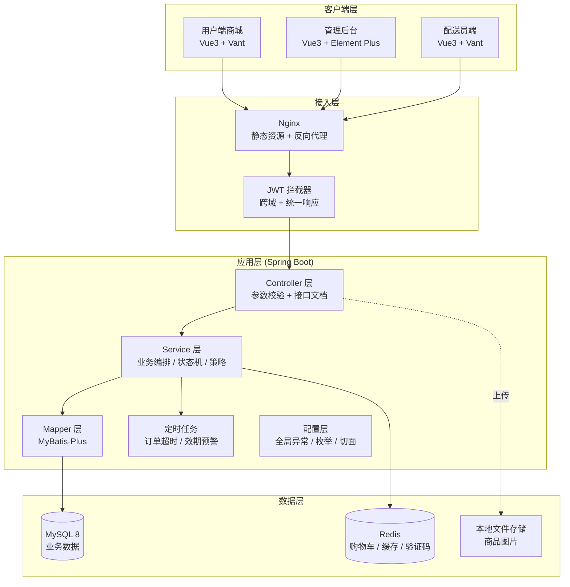

# 轻食预制菜线上订购配送管理系统 —— 系统总体设计

## 一、技术选型

### 1.1 选型清单

| 层次 | 技术 | 版本 | 选型理由（论文可写） |
|---|---|---|---|
| 后端框架 | Spring Boot | 3.2.x | 题目硬性要求；3.x 基于 Jakarta EE 9+，内建 Actuator/自动配置，开箱即用 |
| ORM | MyBatis-Plus | 3.5.x | 单表 CRUD 零 SQL，分页/条件构造器提升开发效率；复杂统计仍可写原生 SQL |
| 数据库 | MySQL | 8.0.x | 支持 ngram 全文索引、CTE、窗口函数，满足统计报表需求 |
| 缓存 | Redis | 7.x | 购物车、验证码、热点商品缓存、库存预扣 |
| 认证 | JWT (jjwt) | 0.12.x | 无状态，前后端分离天然适配；对比 Session 的取舍是论文常考点 |
| 接口文档 | Knife4j (OpenAPI 3) | 4.x | 自动生成在线接口文档，答辩演示友好 |
| 定时任务 | Spring Scheduler | 内置 | 超时订单自动取消、效期预警，无需引入 Quartz 降低复杂度 |
| 报表导出 | EasyExcel | 3.3.x | 订单/销售报表导出 Excel，阿里开源，内存占用低 |
| 地图/距离 | Haversine 公式自实现 | — | **不引入高德/百度 SDK**，避免密钥依赖；用经纬度算球面距离，论文中说明误差与简化假设 |
| 前端框架 | Vue | 3.4+ | Composition API，生态成熟 |
| UI 组件 | Element Plus | 2.x | 管理端表格/表单/树形控件一应俱全 |
| 移动端 UI | Vant | 4.x | 用户端移动端购物体验 |
| 构建 | Vite | 5.x | 冷启动快 |
| 状态管理 | Pinia | 2.x | 轻量、TS 友好 |
| 图表 | ECharts | 5.x | 数据看板可视化 |
| 请求封装 | Axios | 1.x | 拦截器统一处理 token 与错误码 |

### 1.2 为什么前后端分离（论文论证）

| 方案 | 优点 | 缺点 | 结论 |
|---|---|---|---|
| Thymeleaf 服务端渲染 | 开发快、部署单体 | 前后端强耦合、交互体验差、多端复用难 | 放弃 |
| **前后端分离 + JWT** | 职责清晰、可独立部署、多端复用、契合移动端 | 需处理跨域与鉴权 | **采用** |
| 微服务 | 可独立伸缩 | 毕设规模下运维成本过高、徒增复杂度 | 放弃（论文中说明"预留 Service 层拆分可能"） |

> 论文表述建议：*本系统采用前后端分离架构，后端以 RESTful 风格提供无状态接口，认证采用 JWT 无状态令牌。相比单体 MVC 架构，该架构降低了模块耦合度，为后续向服务化演进预留了空间。*

---

## 二、系统总体架构



### 2.1 后端分层职责

| 层 | 包名 | 职责 | 约束 |
|---|---|---|---|
| Controller | `com.freshmeal.controller` | 接收请求、参数校验（`@Valid`）、调用 Service、返回统一 `Result` | **不写业务逻辑** |
| Service | `com.freshmeal.service` + `service.impl` | 业务规则、状态机流转、事务边界、算法实现 | 事务注解只标在 `@Service` 实现类 |
| Mapper | `com.freshmeal.mapper` | 数据访问 | 继承 `BaseMapper`，复杂统计写 XML |
| Entity | `com.freshmeal.entity` | 与表一一对应 | 用 MyBatis-Plus 注解 |
| DTO/VO | `com.freshmeal.dto` / `vo` | 入参 / 出参对象 | **不直接返回 Entity**，避免前端耦合数据库结构 |
| Common | `com.freshmeal.common` | `Result`、`PageResult`、全局异常、`BusinessException` | 统一响应格式 |
| Config | `com.freshmeal.config` | MyBatis-Plus 分页、CORS、WebMvc、Redis、Swagger | |
| Security | `com.freshmeal.security` | JWT 工具、拦截器、注解 `@RequiresRole` | |
| Enum | `com.freshmeal.enums` | `OrderStatus`、`DeliveryStatus`、`PayStatus` 等 | **所有状态值集中定义，禁止魔法数字** |
| Strategy | `com.freshmeal.strategy` | 运费计算、派单算法 | 策略模式，便于扩展 |

### 2.2 统一响应格式

```java
{
  "code": 200,          // 0或200成功，非0失败
  "message": "success",
  "data": { ... },
  "timestamp": 1730000000000
}
```

分页响应：
```java
{
  "code": 200,
  "data": {
    "records": [],      // 当前页数据
    "total": 100,       // 总记录数
    "current": 1,       // 当前页
    "size": 10,         // 每页条数
    "pages": 10         // 总页数
  }
}
```

### 2.3 统一错误码规范

| 段位 | 含义 | 示例 |
|---|---|---|
| 0 / 200 | 成功 | — |
| 400xx | 参数与业务校验失败 | 40001 商品已下架 |
| 401xx | 未认证 / token 失效 | 40101 登录已过期 |
| 403xx | 无权限 | 40301 无权操作该订单 |
| 404xx | 资源不存在 | 40401 订单不存在 |
| 409xx | 状态冲突 | 40901 订单状态不允许该操作 |
| 500xx | 服务器内部错误 | 50000 系统异常 |

> **论文写法**：定义 `BusinessException(int code, String message)`，配合 `@RestControllerAdvice` 全局异常处理器统一捕获，输出结构化错误码而非堆栈。

---

## 三、功能模块划分

### 3.1 模块清单（对应论文 4.x 章节目录）

```
com.freshmeal
├── user        用户端：账号、地址、购物车、订单、评价、收藏、优惠券
├── product     商品域：分类、商品、规格、选项、图集、批次
├── order       订单域：下单、支付、状态机、结算
├── delivery    配送域：配送单、轨迹、区域、派单算法、运费计算
├── merchant    管理端：后台账号、看板、报表、公告、轮播
└── common      公共：统一响应、异常、枚举、工具、配置
```

### 3.2 功能点优先级矩阵

| 编号 | 功能模块 | 优先级 | 说明 |
|---|---|---|---|
| F01 | 用户注册/登录/JWT | **P0** | 三端统一认证体系 |
| F02 | 商品分类浏览/搜索/详情 | **P0** | 首页 + 列表 + 详情 |
| F03 | 购物车增删改查 | **P0** | Redis 或 MySQL 二选一（建议 Redis） |
| F04 | 下单结算（地址/规格/选项/时段/运费试算） | **P0** | 核心交易链路 |
| F05 | 模拟支付 + 支付回调 | **P0** | 沙箱流程，含幂等处理 |
| F06 | 我的订单列表/详情/进度追踪 | **P0** | 订单状态查询 |
| F07 | 订单状态机流转引擎 | **P0** | 统一控制状态迁移 |
| F08 | 后台登录 + RBAC 权限 | **P0** | 注解式权限控制 |
| F09 | 后台商品/分类管理（上下架） | **P0** | 管理端基础 |
| F10 | 后台订单管理与状态干预 | **P0** | 管理端核心 |
| F11 | 配送员管理 + 配送员登录 | **P0** | 配送体系基础 |
| F12 | 派单算法（系统派单 + 抢单） | **P0** | **题眼，必须做** |
| F13 | 运费计算规则引擎 | **P0** | **题眼，必须做** |
| F14 | 配送员取货/送达上报 + 轨迹 | **P0** | 配送状态机 |
| F15 | 数据看板（营业额/订单量/销量榜） | **P0** | 管理端门面 |
| F16 | 用户取消订单 + 超时自动取消 | P1 | 定时任务 |
| F17 | 优惠券（领取/核销/满减计算） | P1 | 营销模块 |
| F18 | 订单评价 + 商家回复 | P1 | 闭环 |
| F19 | 配送区域与运费规则后台配置 | P1 | 规则可配置 |
| F20 | 收藏 / 浏览历史 | P1 | |
| F21 | 公告 / 轮播图管理 | P1 | |
| F22 | 商品批次效期管理 + 临期预警 | P2 | 预制菜特色 |
| F23 | 库存变动流水 + 进销存报表 | P2 | |
| F24 | Excel 报表导出 | P2 | |
| F25 | 售后退款流程 | P2 | |

---

## 四、核心接口清单（RESTful）

### 4.1 用户端 `/api/shop/**`

| 方法 | 路径 | 说明 |
|---|---|---|
| POST | `/auth/register` | 注册 |
| POST | `/auth/login` | 登录，返回 token |
| POST | `/auth/logout` | 登出 |
| GET | `/user/profile` | 个人资料 |
| PUT | `/user/profile` | 修改资料 |
| GET | `/address/list` | 地址列表 |
| POST | `/address` | 新增地址 |
| PUT | `/address/{id}` | 修改地址 |
| DELETE | `/address/{id}` | 删除地址 |
| PUT | `/address/{id}/default` | 设为默认 |
| GET | `/category/tree` | 分类树 |
| GET | `/product/page` | 商品分页（分类/关键词/热量区间筛选） |
| GET | `/product/{id}` | 商品详情 |
| GET | `/product/hot` | 热销榜 |
| GET | `/product/recommend` | 推荐（按健康目标） |
| GET | `/cart/list` | 购物车列表 |
| POST | `/cart` | 加入购物车 |
| PUT | `/cart/{id}` | 修改数量/规格 |
| DELETE | `/cart/{id}` | 删除 |
| POST | `/cart/settle` | **结算预览**（算总价+运费+可用券） |
| POST | `/order` | **提交订单** |
| POST | `/order/{orderNo}/pay` | 发起支付 |
| POST | `/order/{orderNo}/cancel` | 取消订单 |
| GET | `/order/page` | 我的订单分页 |
| GET | `/order/{orderNo}` | 订单详情 |
| GET | `/order/{orderNo}/trace` | 配送进度轨迹 |
| POST | `/order/{orderNo}/review` | 提交评价 |
| POST | `/review/{id}/reply` | 商家回复（后台调用） |
| GET | `/coupon/list` | 我的优惠券 |
| POST | `/coupon/{id}/receive` | 领取优惠券 |

### 4.2 管理端 `/api/admin/**`

| 方法 | 路径 | 说明 |
|---|---|---|
| POST | `/auth/login` | 管理员登录 |
| GET | `/dashboard/overview` | 看板汇总（今日营业额/订单数/用户数/待配送） |
| GET | `/dashboard/trend?days=7` | 营业额趋势折线 |
| GET | `/dashboard/rank?limit=10` | 菜品销量 Top |
| GET | `/dashboard/region` | 区域配送分布 |
| GET/POST/PUT/DELETE | `/product/**` | 商品 CRUD + 上下架 |
| GET/POST/PUT/DELETE | `/category/**` | 分类 CRUD |
| GET | `/order/page` | 订单分页（多条件） |
| GET | `/order/{orderNo}` | 订单详情 |
| PUT | `/order/{orderNo}/status` | 状态干预（接单/出餐/取消） |
| GET/POST/PUT | `/delivery/man` | 配送员管理 |
| GET | `/delivery/order/page` | 配送单列表 |
| PUT | `/delivery/order/{id}/assign` | **人工指派配送员** |
| GET/POST/PUT | `/delivery/area` | 配送区域与运费规则配置 |
| GET/POST/PUT | `/user/**` | 用户管理 |
| GET/POST/PUT | `/coupon/**` | 优惠券管理 |
| GET | `/review/page` | 评价管理 |
| GET/POST/PUT | `/banner/**`、`/notice/**` | 轮播与公告 |

### 4.3 配送员端 `/api/rider/**`

| 方法 | 路径 | 说明 |
|---|---|---|
| POST | `/auth/login` | 配送员登录 |
| GET | `/task/todo` | 待接订单大厅 |
| POST | `/task/{deliveryNo}/grab` | **抢单** |
| GET | `/task/my` | 我的配送单 |
| PUT | `/task/{deliveryNo}/pickup` | 确认取货 |
| PUT | `/task/{deliveryNo}/deliver` | 确认送达 |
| GET | `/task/statistics` | 配送业绩统计 |
| PUT | `/profile/work-status` | 上/下线、休息状态切换 |

---

## 五、核心设计实现（论文第四章重点）

### 5.1 订单状态机（状态模式）

**问题**：如果用 `if (status == 0) { ... } else if (status == 1) { ... }` 散落在 5 个 Service 里，新增状态时要改 5 处，极易出错。

**方案**：定义状态枚举 + 状态迁移表，迁移集中管控。

```java
public enum OrderStatus {
    WAIT_PAY(0, "待支付"),
    WAIT_ACCEPT(1, "待接单"),
    PREPARING(2, "备餐中"),
    WAIT_DELIVER(3, "待配送"),
    DELIVERING(4, "配送中"),
    FINISHED(5, "已完成"),
    REFUNDING(6, "退款中"),
    REFUNDED(7, "已退款"),
    CANCELLED(9, "已取消");

    private final Integer code;
    private final String desc;

    // 允许流转到的目标状态集合（迁移表）
    private final Set<OrderStatus> nextStates;

    public boolean canTransferTo(OrderStatus target) {
        return nextStates.contains(target);
    }
}
```

```java
@Service
public class OrderStatusManager {

    /** 状态迁移表：key=当前状态，value=允许迁移到的目标状态集合 */
    private static final Map<OrderStatus, Set<OrderStatus>> TRANSITIONS = Map.of(
        WAIT_PAY,     Set.of(WAIT_ACCEPT, CANCELLED),
        WAIT_ACCEPT,  Set.of(PREPARING, CANCELLED),
        PREPARING,    Set.of(WAIT_DELIVER),
        WAIT_DELIVER, Set.of(DELIVERING, CANCELLED),
        DELIVERING,   Set.of(FINISHED),
        FINISHED,     Set.of(),
        REFUNDING,    Set.of(REFUNDED),
        REFUNDED,     Set.of(),
        CANCELLED,    Set.of()
    );

    /**
     * 执行状态迁移：校验合法性 -> 落库 -> 记日志
     */
    @Transactional(rollbackFor = Exception.class)
    public void transfer(Order order, OrderStatus target, Operator operator) {
        OrderStatus current = OrderStatus.of(order.getStatus());
        if (!TRANSITIONS.get(current).contains(target)) {
            throw new BusinessException(40901,
                String.format("订单当前状态[%s]不允许变更为[%s]", current.getDesc(), target.getDesc()));
        }
        // 1. 更新主表
        order.setStatus(target.getCode());
        // 2. 记流转日志（用于订单进度展示 + 审计）
        orderStatusLogMapper.insert(buildLog(order, current, target, operator));
        // 3. 触发状态对应的副作用（见 5.1.1）
        afterTransfer(order, target);
    }
}
```

**5.1.1 状态副作用（钩子）**

| 目标状态 | 副作用 |
|---|---|
| WAIT_ACCEPT | 扣减库存（乐观锁）、生成配送单 |
| PREPARING | 通知商家备餐（此处仅更新备餐时间） |
| WAIT_DELIVER | 触发派单算法 |
| DELIVERING | 同步配送单状态为"配送中" |
| FINISHED | 更新配送单为已送达、结算配送员收入、更新用户累计消费 |
| CANCELLED | **回补库存**、作废配送单、退款 |

> **论文价值**：状态机的引入让"订单流转"从散落代码变成集中管控的可视化规则，第四章可配**状态图 + 迁移表 + 钩子设计类图**，这是"系统设计"而非"系统实现"的核心体现。

### 5.2 运费计算规则引擎

**问题**：运费规则如果散落在代码里 `if`，改个价格要发版；而且轻食配送有"满额免配送""夜间附加""不同区域不同价"。

**方案**：规则数据化 + 策略模式。

```java
public interface FreightRule {
    /** 计算运费 */
    BigDecimal calculate(FreightContext context);
}
```

```java
@Component
public class DefaultFreightRule implements FreightRule {

    @Override
    public BigDecimal calculate(FreightContext ctx) {
        DeliveryArea area = ctx.getArea();
        BigDecimal distance = ctx.getDistance();          // km

        // 1. 起步价（含首公里）
        BigDecimal freight = area.getBaseFee();

        // 2. 超出首公里的里程费
        BigDecimal extraKm = distance.subtract(ONE_KM).max(BigDecimal.ZERO);
        freight = freight.add(extraKm.multiply(area.getPerKmFee()));

        // 3. 夜间时段附加费（22:00 - 次日06:00）
        if (ctx.isNightTime()) {
            freight = freight.add(area.getNightSurcharge());
        }

        // 4. 满额免配送费
        if (area.getFreeThreshold().compareTo(BigDecimal.ZERO) > 0
                && ctx.getGoodsAmount().compareTo(area.getFreeThreshold()) >= 0) {
            freight = BigDecimal.ZERO;
        }
        return freight.setScale(2, RoundingMode.HALF_UP);
    }
}
```

**距离计算（Haversine 公式）**

```java
public static double calcDistance(BigDecimal lon1, BigDecimal lat1,
                                  BigDecimal lon2, BigDecimal lat2) {
    double R = 6371.0088; // 地球平均半径 km
    double dLat = Math.toRadians(lat2.doubleValue() - lat1.doubleValue());
    double dLon = Math.toRadians(lon2.doubleValue() - lon1.doubleValue());
    double a = Math.sin(dLat / 2) * Math.sin(dLat / 2)
             + Math.cos(Math.toRadians(lat1.doubleValue()))
             * Math.cos(Math.toRadians(lat2.doubleValue()))
             * Math.sin(dLon / 2) * Math.sin(dLon / 2);
    double c = 2 * Math.atan2(Math.sqrt(a), Math.sqrt(1 - a));
    return R * c;
}
```

> **论文说明**：由于直线路径距离忽略了实际道路走向，实际配送距离约为直线距离的 1.3–1.4 倍，因此系统在下单提示中对用户展示"预估距离"，并在此处说明该近似假设。同时给出与真实地图 SDK 方案的对比，说明本方案降低了第三方依赖与密钥管理成本。

### 5.3 派单算法（核心亮点）

**问题**：订单进入"待配送"后，系统要决定派给谁。若随机派单，会导致"有人闲着有人爆单"、配送时长不可控。

**方案：多因子加权评分 + 候选集筛选**

**Step 1 候选集筛选**（SQL 层）

```sql
SELECT * FROM t_delivery_man
WHERE status = 1              -- 账号启用
  AND online_status = 1       -- 在线
  AND work_status = 0         -- 空闲
  AND (service_area_id = ? OR service_area_id IS NULL)  -- 覆盖该区域
  AND today_order_count < max_order_num                  -- 未达负载上限
```

**Step 2 多因子打分**

| 因子 | 权重 | 计算方式 | 含义 |
|---|---|---|---|
| 距离因子 | 0.5 | `max(0, 1 - d / d_max)` | 越近得分越高（`d_max` 取 10km） |
| 负载因子 | 0.3 | `1 - 当前在途单量 / max_order_num` | 越闲得分越高 |
| 评分因子 | 0.2 | `rating / 5` | 服务质量 |

综合得分：`score = 0.5 × 距离分 + 0.3 × 负载分 + 0.2 × 评分分`

**Step 3 排序并选取最优**

```java
public DeliveryMan selectBest(List<DeliveryMan> candidates, Order order) {
    double dMax = 10.0;
    List<ScoredCandidate> scored = candidates.stream()
        .map(m -> {
            double distance = DistanceUtil.calcDistance(
                    m.getLongitude(), m.getLatitude(),
                    order.getLongitude(), order.getLatitude());
            double distanceScore = Math.max(0, 1 - distance / dMax);
            double loadScore = 1.0 - (double) m.getTodayOrderCount() / m.getMaxOrderNum();
            double ratingScore = m.getRating().doubleValue() / 5.0;
            double total = 0.5 * distanceScore + 0.3 * loadScore + 0.2 * ratingScore;
            return new ScoredCandidate(m, total, distanceScore, loadScore, ratingScore, distance);
        })
        .sorted(Comparator.comparingDouble(ScoredCandidate::getTotalScore).reversed())
        .toList();

    // 落库派单日志，便于论文展示算法中间过程
    persistAssignLog(order.getId(), scored);
    return scored.isEmpty() ? null : scored.get(0).getMan();
}
```

**Step 4 双通道派单**

- **系统自动派单**：定时任务扫描 `status = WAIT_DELIVER` 且创建超过 N 分钟的订单，执行上述算法。
- **配送员抢单**：待分配订单对在线空闲配送员可见，先到先得（数据库乐观锁更新 `status` 保证并发下只有一人抢到）。

> **论文价值**：这是整个系统最有技术含量的部分。第四章可给出"候选集筛选 → 因子归一化 → 加权求和 → 排序选取"完整流程图，配合 `t_delivery_man_log` 表中的真实打分数据，以及与"随机派单/最近优先单一策略"的对比实验表（配送平均时长、平均负载均衡度两项指标），形成可验证的算法改进结论。

### 5.4 库存扣减与超卖控制

```java
@Transactional(rollbackFor = Exception.class)
public void deductStock(Long productId, Integer quantity) {
    // 乐观锁：条件更新，version 不匹配则更新 0 行
    int rows = productMapper.deductStockWithVersion(productId, quantity);
    if (rows == 0) {
        throw new BusinessException(40001, "商品库存不足或并发冲突，请重试");
    }
    // 记录库存流水
    inventoryLogMapper.insert(...);
}
```

```xml
<update id="deductStockWithVersion">
    UPDATE t_product
    SET stock = stock - #{quantity},
        sales_count = sales_count + #{quantity},
        version = version + 1
    WHERE id = #{productId}
      AND version = #{version}
      AND stock >= #{quantity}
</update>
```

### 5.5 订单超时自动取消（定时任务）

```java
@Scheduled(cron = "0 */1 * * * ?")   // 每分钟执行
public void cancelTimeoutOrders() {
    List<Order> timeout = orderMapper.selectTimeoutOrders(PAY_EXPIRE_MINUTES);
    for (Order order : timeout) {
        // 补偿：事务内改状态 + 回补库存 + 释放优惠券
        transactionTemplate.executeWithoutResult(s -> {
            orderStatusManager.transfer(order, OrderStatus.CANCELLED,
                    Operator.system("支付超时自动取消"));
            stockService.restore(order.getItems());
            couponService.release(order.getUserCouponId());
        });
    }
}
```

### 5.6 模拟支付流程

```
用户点击支付
   ↓
POST /order/{orderNo}/pay  → 创建 t_payment 记录(status=0)，返回支付页
   ↓
用户选择"微信支付"→ 前端跳转模拟收银台 → POST /pay/mock/notify
   ↓
后端校验：订单归属 + 状态=待支付 + 支付流水未成功（幂等）
   ↓
更新 t_payment(status=1) + t_order(pay_status=1, pay_time)
   ↓
触发订单状态迁移：WAIT_PAY → WAIT_ACCEPT
   ↓
生成配送单 → 触发派单
```

**幂等性设计**：`t_payment` 上 `pay_no` 唯一索引 + 回调前检查 `status != 1`，重复回调直接返回成功而不重复改状态。论文中可画出标准支付时序图（预支付→用户支付→异步回调→商户验签→更新订单→通知用户），并说明真实项目中应接第三方支付 SDK 的验签逻辑。

---

## 六、数据库访问层设计

### 6.1 分页查询

```java
Page<Product> page = productMapper.selectProductPage(pageParam, query);
```

```java
// Service 中统一转换
public PageResult<ProductVO> pageProducts(ProductQuery query) {
    IPage<Product> page = productMapper.selectProductPage(
            Page.of(query.getCurrent(), query.getSize()), query);
    return PageResult.of(page.getRecords(), page.getTotal(), page.getCurrent(), page.getSize());
}
```

### 6.2 统计报表 SQL（管理端看板）

**近 7 日营业额趋势**

```sql
SELECT DATE(create_time) AS date,
       COUNT(*)           AS order_count,
       SUM(pay_amount)    AS amount
FROM t_order
WHERE create_time >= DATE_SUB(CURDATE(), INTERVAL 6 DAY)
  AND status IN (4,5,6,7)      -- 已配送/已完成/退款中/已退款
  AND deleted = 0
GROUP BY DATE(create_time)
ORDER BY date;
```

**菜品销量 Top10**

```sql
SELECT oi.product_id,
       oi.product_name,
       SUM(oi.quantity) AS total_qty,
       SUM(oi.subtotal)  AS total_amount
FROM t_order_item oi
JOIN t_order o ON o.id = oi.order_id
WHERE o.create_time >= DATE_SUB(CURDATE(), INTERVAL 30 DAY)
  AND o.status IN (4,5)
GROUP BY oi.product_id, oi.product_name
ORDER BY total_qty DESC
LIMIT 10;
```

---

## 七、非功能性设计

| 维度 | 设计措施 |
|---|---|
| 安全 | BCrypt 密码加密；JWT 无状态认证 + 注解式 RBAC；SQL 参数化防注入；上传文件类型与大小校验；接口签名与限流（Redis 计数器） |
| 性能 | Redis 缓存首页分类/热销商品；列表查询强制分页；关键字段建索引；慢 SQL 日志监控 |
| 可靠性 | 事务边界覆盖"下单-扣库存-生成配送单"；支付幂等；超时任务兜底 |
| 可观测 | Actuator 健康检查；全局日志切面记录请求耗时；操作日志 AOP |
| 易用性 | 前端表单校验 + 后端 `@Valid` 双重校验；统一错误提示；空状态引导页 |
| 可维护性 | 枚举集中管理；DTO/VO 与 Entity 隔离；公共模块抽取；注释与日志规范 |

---

## 八、目录结构规划

```
FreshMeal/
├── docs/                       # 设计文档（本文档所在）
│   ├── 01-需求分析.md
│   ├── 02-数据库设计.md
│   ├── 03-系统总体设计.md
│   ├── 04-论文大纲与写作指引.md
│   └── 05-开发计划与进度.md
├── server/                     # Spring Boot 后端
│   └── src/main/java/com/freshmeal/
│       ├── common/  config/  controller/  service/  mapper/
│       ├── entity/  dto/  vo/  enums/  strategy/  security/  job/
│   └── src/main/resources/
│       ├── application.yml
│       ├── mapper/*.xml
│       └── db/init.sql
├── web-shop/                   # 用户端商城
├── web-admin/                  # 管理后台
├── web-rider/                  # 配送员端
└── README.md
```

> **建议**：三端可共用一套 `web-common`（请求封装、鉴权、通用组件），但作为三个独立工程分别启动，便于分别演示与答辩。

---

## 九、答辩高频问题与应答要点

| 提问 | 应答方向 |
|---|---|
| "为什么不用微服务？" | 毕设规模下单体更易交付与演示；架构上 Service 层已按业务域分包，后续可平滑拆分为独立服务 |
| "购物车为什么放 Redis？" | 高频读写、字段可序列化、天然支持 TTL；但下单后需同步落库，此处需说明双写一致性策略 |
| "订单金额会不会算错？前端算还是后端算？" | **后端算**。前端金额仅作展示，提交订单时后端重新查价计算并返回差额校验，这是防篡改的关键 |
| "你的系统有什么创新点？" | ①订单/配送双状态机集中管控；②多因子加权派单算法并留痕可验证；③配置化运费规则引擎；④轻食营养属性（热量/过敏原/效期）驱动的领域建模 |
